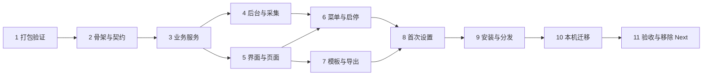

# 个人考勤 Mac 桌面版详细施工计划

> **执行者必读：** 按 `superpowers:executing-plans` 在当前会话逐项实施；如果用户明确选择代理分工，再使用 `superpowers:subagent-driven-development`。任务以复现失败、最小实现、验证通过的顺序推进，用复选框记录完成情况。

**目标：** 交付一个 Mac 个人考勤应用：程序员一行命令即可在本机构建安装，非程序员可直接使用维护者发送的通用包；界面退出后后台仍采集，顶部菜单栏可停止后台；并预留 Windows 系统适配接口。

**架构：** 一个 Electron 应用包按参数运行 `gui` 和 `agent` 两种角色。

- **agent：** 由用户级 launchd 启动项启动，拥有菜单栏，通过 utilityProcess 运行采集工作进程，负责原生监听器、网络探测、历史补齐和定时维护。
- **gui：** 拥有窗口和自己的业务工作进程。
- **数据库：** 两个工作进程共享 SQLite，即 WAL、等锁时间、迁移写锁和维护租约。先读后写的操作一律在一个写事务中完成。
- **角色之间：** 不建立常驻通信。状态通过数据库记录和 `launchctl` 查询，启停通过写入或移除启动项完成，菜单栏打开界面则通过系统启动 gui 角色。

**技术栈：** Electron、React、TypeScript、Vite（界面）、esbuild（main/preload/worker）、@electron/packager、@electron/fuses、Node 内置 SQLite、Swift 原生监听器、launchd、Vitest、Playwright Electron 测试。

**规格：** [重构方案](2026-10-14-electron-mac-spec.md)。[各轮评审及修订原因](2026-10-14-electron-mac-self-review.md)。[任务 1 打包验证记录](desktop-spike.md)，本计划已按其结论修订。考勤规则按现行[业务规格](../spec.md)保留；桌面生命周期和分发方式按新的重构方案执行。

## 全局约束

**平台与分发**

- 首版支持 macOS 13 及以上的 Apple Silicon 和 Intel。程序员在本机构建本机架构的包；发给非程序员的是通用包。
- 不依赖 Apple 开发者账号：默认临时签名，可选本机自建证书，不做公证。
- 构建分两套配置：
  - 正式构建：用于安装和分发，关闭不需要的运行时开关。
  - 测试构建：仅用于 Playwright，允许调试参数；使用不同的应用名称、标识和启动项标签，不会被安装。

**界面与后台行为**

- 退出考勤界面后，后台仍采集，菜单栏显示状态并提供停止入口。
- × 仅隐藏窗口并保留草稿；⌘Q 仅退出界面；“停止后台采集”只停止后台并移除登录启动，不关闭界面。
- 后台未启用、已停止或被系统关闭时，界面仍可设置、核对、复制和导出。
- 后台在系统设置中被关闭时（启动项文件在、任务未加载），应用不自行重新加载，只提供系统设置入口。
- 定时维护在界面或后台任一运行时执行，按租约协调；两者都没运行的日子，下一次启动时补跑。

**数据库与事件**

- 数据库允许 gui 与 agent 的两个工作进程同时连接，沿用 WAL、`busy_timeout`、`BEGIN IMMEDIATE` 迁移和维护租约。不新增独立事件日志、操作回执或进程间常驻通信。
- 打开数据库：先设置 `busy_timeout`，再切换 `journal_mode=WAL`；切换遇到 `SQLITE_BUSY` 时由程序退避重试（等锁时间对它无效）。
- 事务边界：
  - 先读后写的操作必须在 `BEGIN IMMEDIATE` 写事务中完成。
  - 以 `InTx` 结尾的函数只在调用方已持有事务时使用，自身不开启事务；公开函数各自开启事务，不互相嵌套。
  - 事务内不生成 Excel，也不做其他耗时 IO。
  - pmset 补齐、维护等批量写入拆成多个短事务，单个事务的耗时远小于 `busy_timeout`，避免另一方一直等不到写锁。
- 采集事件直接写入数据库，采集连接使用 `synchronous=FULL`；遇到 `SQLITE_BUSY` 时退避重试，不丢弃事件。停机期间的电源事件由 pmset 补齐；网络不靠历史猜测。
- 复制邮件前在工作进程中校验完整快照版本；导出在生成前和登记／锁定前各校验一次。版本覆盖记录、资料、模板、规则与提交限制。
- 工作进程超时或崩溃后，必须确认旧进程已经退出，才能启动新进程并重新读取。
- 迁移版本只能追加。过渡期内只追加表或可空列，保证旧程序仍可读写。首版计划不新增迁移。

**文件与隐私**

- agent 及其工作进程只写数据目录和日志目录，不访问桌面、文稿、下载等受保护目录；写入用户目录一律由 gui main 完成。
- 数据仍只保存在本机，不采集键鼠内容、窗口标题或屏幕画面，不引入云同步。
- Mac 数据目录沿用 `~/Library/Application Support/kaoqin/`，日志沿用 `~/Library/Logs/kaoqin/`。Electron 缓存放在 `electron/<role>/`，不使用旧版的 `app/` 子目录。

**业务规则**

- 无记录工作日待补录；确认和正式导出不能强制跳过。有未保存修改或操作进行中时，不能复制邮件、导出 Excel。
- 业务时间仍为东京时间，默认 05:00 分界，不跟随电脑系统时区。
- 用户界面和文档使用中文，现有公司 Excel 类别值和邮件格式按原业务契约保留。

**开发与测试**

- 开发和测试使用隔离数据目录和独立启动项标签。维护者的正式服务只在任务 10 明确迁移时停止。
- 开发用 Node 24.21.0（与 Electron 内置版本一致），由 nvm 和仓库的 `.nvmrc` 切换。维护者新开的 shell 默认仍是 Homebrew 的 node@22，旧部署不受影响。
- 默认按任务编号顺序施工。

## 验收最容易遗漏的情况

| 情况 | 用户应看到的行为 | 负责的任务 |
| --- | --- | --- |
| 界面与后台同时先读后写 | 没有嵌套事务错误或 `SQLITE_BUSY_SNAPSHOT`；采集事件不丢 | 任务 1、3、11 |
| 首次设置时界面与后台同时打开新库 | 不报“数据库忙”；WAL 切换由程序重试 | 任务 3、8 |
| 生成 Excel 期间采集或维护改变了记录 | 不登记导出、不锁定，提示重新生成 | 任务 3、7 |
| 从未启用后台、后台被系统关闭 | 界面可设置、核对、导出；打开过界面的日子有备份；状态如实显示 | 任务 5、6、8 |
| 采集工作进程或监听器崩溃、后台被强杀 | 自动重启；停机期间的电源事件由 pmset 补齐；状态不误报正常 | 任务 4、6、11 |
| 业务工作进程崩溃或超时 | 确认旧进程退出后再重读；草稿保留；不自动重发 | 任务 5、7 |
| 资料、模板、规则变更；导出后确认状态变化 | 旧邮件和导出提示重新生成 | 任务 3、7 |
| ×、⌘Q、强制终止 gui | 后台和菜单栏仍在，事件继续落库 | 任务 1、6、11 |
| 明确停止后台后重新登录 | 不被 KeepAlive 或登录拉起；界面不受影响 | 任务 1、6 |
| 后台运行时从 Finder、程序坞或通知打开应用 | 只出现一个界面窗口和一个程序坞图标；点通知不重复启动界面 | 任务 1、6 |
| 在系统设置中关闭后台项目 | 显示“已在系统设置中关闭”并提供入口；应用不自行重新加载 | 任务 6、8 |
| 菜单栏图标被刘海挡住；登录项显示为可执行文件名和通用图标 | 说明文档告诉用户如何找回和识别，不误关后台 | 任务 6、9 |
| 导出到文稿、桌面或 iCloud 目录 | 由界面进程写入；后台不触发隐私授权 | 任务 7 |
| 首次设置时还没有网络记录 | 可以跳过公司网络，之后再提示标记 | 任务 8 |
| 重新构建后签名身份变化；旧版本后台仍在运行 | 不需要重新允许后台（已实测）；版本不一致时提示重启后台，不静默失效 | 任务 1、6、9 |
| 安装命令中断；后台子进程未退出 | 未退出时不替换；再次执行先恢复再安装 | 任务 9 |
| 应用装在中文路径下，安装脚本查找应用进程 | `ps` 在 UTF-8 locale 下运行，不因路径被转义而漏判 | 任务 9 |
| 带隔离标记的通用包；从“下载”直接打开 | 引导移动到应用目录，不注册失效路径 | 任务 1、8、9 |
| 维护者的旧版正在运行；迁移中断 | 不双重采集；可按脚本回退旧版 | 任务 8、10 |
| 中文路径、Intel、没有开发环境 | 辅助程序可启动，SQLite 可备份，资源可读取 | 任务 1、9、11 |

## 调查结论和版本基线

### 现有代码

现有项目的业务代码大部分集中在 `src/lib/`，有 142 项回归测试，分布在 17 个文件中，2026-10-14 已全部通过。

- 依赖 Next.js 的部分主要是 `src/app/`、组件中的路由刷新和 Server Actions，以及 `src/lib/db/server.ts` 的 `server-only`。
- 后台采集在 `src/collector/main.ts`，原生事件在 `power-listener.swift`。
- 维护任务目前由 Web instrumentation 启动，必须迁出。

以下现状直接影响设计：

- 采集程序和 Web 服务已经在同时读写同一个数据库：`src/lib/db/index.ts` 中有 WAL、等锁时间和 `BEGIN IMMEDIATE` 迁移，`src/lib/tasks.ts` 中有维护租约。本方案沿用多进程共享，但必须先修正事务边界：
  - `transaction()` 使用延迟的 `BEGIN`。
  - `computeMonth()` 内部自行开启事务，先读后写（更新 `day_auto`、清除确认）。
  - `saveDay`、`confirmDay`、`confirmCleanDays`、`setMonthLocked`、`exportMonth` 都是先调用 `computeMonth()`，再另开事务写入；`restoreAuto` 在延迟事务里先读后写。
  - 外部评审已复现两个问题：在 `computeMonth()` 外再包一层事务，会报嵌套事务错误；两个连接并发时，延迟事务先读后写会得到 `SQLITE_BUSY_SNAPSHOT`，这种情况等锁时间无法处理。现有 Web 和采集程序并存时，也存在同样的隐患。[SQLite 隔离说明](https://www.sqlite.org/isolation.html)
- `openDb` 先执行 `journal_mode=WAL` 再设置 `busy_timeout`。任务 1 实测：两个进程同时打开一个新库时，切换 WAL 直接返回 `SQLITE_BUSY`，有时两边都失败；调换顺序后仍偶有失败，必须由程序重试。现有部署的库早已处于 WAL 模式，问题主要出现在新建数据库时，也就是桌面版首次设置的场景。
- 对重复的相同请求，`saveDay`、`restoreAuto`、`confirmCleanDays`、`setMonthLocked` 都不会产生新的修改；`confirmDay` 重复执行只更新确认时间，并多一条历史记录。
- `exportMonth` 先写文件，再在事务中登记导出和锁定。但登记前没有再次核对记录，而且它会直接写入设置中的导出目录，桌面版须分别改为两次核对和由 gui main 复制。
- 旧程序的 `migrate()` 在库版本不低于自身最新版本时直接返回（`src/lib/db/index.ts:40`），因此只追加表或列时，旧程序仍能工作。
- 旧部署把程序放在数据目录的 `app/` 下：Web 在 `app/web`，其中含 `.env.local`；采集程序是 `app/collector.mjs` 和 `app/power-listener`。对应的启动项为 `local.kaoqin.web` 和 `local.kaoqin.collector`。
- 只有采集程序会记录网络。首次设置时数据库里通常还没有网络，没法立即标记公司网络。

### 版本基线

下表是截至 2026-10-14 的施工基线。其中 electron 和 vite 的版本就是 npm 上当前的 latest。安装时使用精确版本和锁文件，以后升级单独验证。

| 依赖 | 基线 | 用途 |
| --- | --- | --- |
| electron | 44.7.2 | 内置 Node 24.21.0；官方发布资源含 darwin-arm64 和 darwin-x64 |
| @electron/packager | 20.3.0 | 生成 .app，支持 arm64、x64 和 universal |
| @electron/fuses | 2.1.3 | 按构建配置设置运行时开关 |
| vite / @vitejs/plugin-react | 8.3.4 / 6.1.2 | React 界面构建 |
| react-router | 7.18.4 | HashRouter；v7 推荐直接从 `react-router` 导入 |
| @tailwindcss/vite | 4.3.3 | 替换 Turbopack 的 CSS 构建入口 |
| @testing-library/react / user-event | 16.3.3 / 14.6.8 | 真实组件交互回归 |
| jsdom | 30.1.2 | 组件测试环境，Node 24 时要求不低于 24.15.0 |
| @playwright/test | 1.64.0 | 测试构建上的窗口与生命周期集成测试 |
| React、业务库、Vitest、esbuild | 先沿用当前锁文件 | 避免同时升级业务依赖 |

### 工具选择说明

- **Node 版本：** 开发和 CI 改用 Node 24（不低于 24.15.0），与 Electron 内置的 Node 主版本一致，`engines` 改为 `>=24.15 <25`。维护者本机已用 nvm 安装 24.21.0，与 Electron 44.7.2 内置的版本相同，两者的 SQLite 都是 3.53.4；仓库提供 `.nvmrc`。旧部署脚本固定使用 Homebrew 的 node@22，过渡期不改；`engines` 不匹配只会告警。任务 1 已在 Node 24 下跑通现有 142 项测试、类型检查和 lint，并在 Electron 工作进程中验证了 SQLite。
- **npm 11：** Node 24 自带的 npm 11 默认跳过依赖的安装脚本，需要的包要在 `package.json` 的 `allowScripts` 中放行。Electron 44 不再依赖安装脚本，在首次使用时下载，或用 `install-electron` 预先下载，所以不需要放行；目前只放行 esbuild。
- **不使用 Electron Forge：** 只需要生成 .app 和 zip，直接用 packager 加系统自带的 `codesign`、`ditto`、`lipo`、`plutil` 即可，减少对插件生命周期的依赖。
- **Playwright：** 它对 Electron 的支持仍标为实验性，而且启动时需要 Node 调试参数，所以只在测试构建上运行。核心与组件测试由 Vitest 承担；正式构建由脚本检查加人工清单验收。[Playwright Electron 支持](https://playwright.dev/docs/api/class-electron)
- **剪贴板：** Electron 44 在 renderer 中移除了 `clipboard` 模块，复制邮件由 gui main 完成。[Electron 44 变更](https://www.electronjs.org/docs/latest/breaking-changes)

## 文件结构和责任边界

保留 `src/lib/` 作为业务核心，不为了重构而移动全部旧文件。

```text
src/lib/                         原判定、数据库、Excel、草稿和邮件逻辑
src/shared/
  contracts.ts                  界面请求、响应、快照和后台状态类型
  validation.ts                 请求输入校验，不接受任意命令、SQL 或路径
src/core/
  service.ts                    业务命令分发、写事务与统一快照
  export-flow.ts                导出的准备、生成、二次核对与登记
  profile.ts                    个人资料读写与旧 .env.local 解析
  snapshot-revision.ts          完整业务快照的稳定版本
  schema-guard.ts               迁移前备份与库版本兼容检查
src/platform/
  contracts.ts                  平台能力、路径、采集、后台启动项契约
  index.ts                      根据 darwin / win32 选择适配
  macos/paths.ts                数据、日志、缓存路径与应用位置检测
  macos/power.ts                复用原生监听器
  macos/network.ts              复用网络探测
  macos/history.ts              复用 pmset 历史读取
  macos/launch-agent.ts         生成 plist、bootstrap / bootout、状态查询、打开界面
  macos/processes.ts            按应用包路径查找并等待进程退出
  windows/unsupported.ts        未支持状态，禁止调用 Mac 命令
src/agent/
  main.ts                       后台角色：菜单栏、采集工作进程监护、打开界面
  collector-worker.ts           采集工作进程：监听、写库、补齐、维护
  tray.ts                       菜单项与状态显示
src/desktop/
  entry.ts                      识别角色，设置角色缓存目录与单实例锁
  main.ts                       界面角色：窗口、对话框、剪贴板、后台启停
  business-worker.ts            界面的业务工作进程
  worker-host.ts                启动工作进程、请求排队、超时、确认退出与重启
  background.ts                 汇总后台状态，执行启用与停止
  files.ts                      模板选择、导出复制与另存
  clipboard.ts                  按已保存快照复制邮件
  window-lifecycle.ts           隐藏、恢复、退出及未保存编辑保护
  preload.ts                    只暴露 window.kaoqin 的允许接口
  protocol.ts                   kaoqin://app/ 静态资源白名单
  renderer/                     React 页面、路由、数据刷新、组件适配
src/collector/                   现有采集代码，由 platform/macos 复用
scripts/desktop/
  doctor.mjs                    检查 macOS、Node、swiftc 和下载条件
  build.mjs                     按正式／测试配置构建界面、main/preload/worker 和原生程序
  package.mjs                   packager 打包、fuses、签名与校验
  install.mjs                   安装或升级到 ~/Applications，含中断恢复
  uninstall.mjs                 停止后台，移除启动项和应用，保留数据
  dist.mjs                      通用包与 zip
  release-smoke.mjs             正式构建的安装验收脚本
  migrate-legacy.mjs            维护者本机一次性迁移与回退
resources/icons/                菜单栏模板图标
vite.renderer.config.ts         React、HashRouter、Tailwind 构建
vitest.desktop.config.ts        桌面组件测试，不改变原测试集合
playwright.desktop.config.ts    测试构建上的窗口与生命周期集成测试
tests/desktop/                  核心、平台、组件测试
tests/desktop-e2e/              测试构建上的 Electron 测试
doc/desktop-install.md          非程序员首次打开、升级、卸载的图文说明
doc/refactor/                   本方案、计划、实测验证与验收记录
```

迁移阶段保留 `src/app/` 与现有部署脚本，便于业务对照和回退，到任务 11 再移除。

## 接口约定

### 角色、路径与后台状态

以下类型在任务 2 定义。现有的 `PowerEvent`、`NetworkInfo`、`DayResult`、`Settings`、`MailProfile`、`TemplateWorkRules` 复用原定义，不另造同义类型。

```ts
type AppRole = "gui" | "agent";
type BuildProfile = "release" | "test";
type LaunchAgentState = "notInstalled" | "loaded" | "blockedBySystem";
type CollectionHealth = "starting" | "running" | "degraded" | "stopped";
interface RuntimePaths {
  dataDir: string; logsDir: string; electronDir: string; // electronDir = <dataDir>/electron/<role>
  stagingDir: string; installStateFile: string;          // installStateFile = <dataDir>/install/state.json
  defaultTemplatePath: string; nativeDir: string;
  launchAgentLabel: string; launchAgentPlist: string;
}
// 扩展现有 collectorState 设置项，只追加可选字段，旧程序仍可读取。
interface CollectorState {
  mode: "power"; pid: number; helper_pid: number | null;
  ready: boolean; running: boolean; last_event_at: number | null;
  version?: string; started_at?: number; failures?: number; reason?: string;
}
// gui main 汇总得到，不写入数据库。
interface BackgroundStatus {
  agent: LaunchAgentState; health: CollectionHealth;
  lastEventAt: number | null; agentVersion: string | null;
  versionMismatch: boolean; reason?: string;
}
interface PlatformAdapter {
  id: "darwin" | "win32";
  capabilities: { livePowerEvents: boolean; historyBackfill: boolean;
    networkIdentity: boolean; backgroundAgent: boolean };
  paths: RuntimePaths;
  listenPowerEvents(handlers: { ready(pid: number): void;
    event(event: PowerEvent): void; failure(message: string): void }): { stop(): void };
  probeNetwork(): Promise<NetworkInfo>;
  readPowerHistory(): Promise<string | null>;
  agentState(): Promise<LaunchAgentState>;
  enableAgent(executable: string): Promise<void>;  // 写入 plist 并 bootstrap；blockedBySystem 时拒绝
  disableAgent(): Promise<void>;                   // 先移除 plist，再 bootout
  openBackgroundSettings(): Promise<void>;         // 打开“登录项与扩展”设置页
  launchGui(route?: "settings"): Promise<void>;    // open -n -a <应用> --args --role=gui
  appLocationProblem(executable: string): "translocated" | "volume" | null; // 路径含 /AppTranslocation/ 或在 /Volumes/ 下
  waitAppProcessesExit(bundlePath: string, timeoutMs: number): Promise<boolean>; // ps 须在 LC_ALL=en_US.UTF-8 下运行
}
```

后台状态由启动项文件和 launchd 的加载状态共同判定：

| 启动项文件 | `launchctl print` | `LaunchAgentState` |
| --- | --- | --- |
| 不存在 | — | `notInstalled`：未启用，或已由用户停止 |
| 存在 | 能找到任务 | `loaded`：已启用，运行与否再看 `collectorState` |
| 存在 | 找不到任务 | `blockedBySystem`：在系统设置中被关闭 |

- 明确停止时移除启动项。关机、退出登录、`SIGTERM` 和崩溃不改动启动项。因此不需要另外保存启用选择。
- 任务 1 实测：在系统设置中关闭后台项目时，系统卸载任务并保留启动项文件，`launchctl print-disabled` 没有变化。此时应用自行 `bootstrap` 仍会成功，但那会绕过用户的选择，所以 `blockedBySystem` 下不重新加载，只调用 `openBackgroundSettings()`。用户在系统设置中重新打开后，系统立即加载任务。
- 安装中断等原因也可能造成“文件在、任务不在”，这种情况由安装脚本的恢复流程处理，界面统一按 `blockedBySystem` 提示。

`--data-dir=` 和 `--label-suffix=` 只用于开发、测试和正式构建的安装验收；正式使用时取默认值。

### 事务与导出流程

以下函数在任务 3 定义：

```ts
function writeTransaction<T>(db: Db, fn: () => T): T;         // BEGIN IMMEDIATE；忙时按 busy_timeout 等待
function computeMonthInTx(db: Db, ym: string, now: number): DayResult[]; // 调用方须已持有写事务
function computeMonth(db: Db, ym: string, now?: number): DayResult[];    // = writeTransaction + computeMonthInTx
interface ExportInput { ym: string; days: DayResult[]; template: Buffer; templateMeta: TemplateMeta;
  inputRevision: string; warnings: string[]; draft: boolean; lock: boolean; now: number }
function prepareExport(db: Db, ym: string, options): ExportInput;              // 写事务内：计算、检查、核对版本、读模板
function renderExport(input: ExportInput): Promise<Buffer>;                    // 事务外，不访问数据库
function commitExport(db: Db, input: ExportInput, tempFile: string): ExportCommit; // 新写事务：再次核对后改名并登记
```

**`commitExport` 的流程：**

1. 在写事务内调用 `computeMonthInTx` 重新计算版本。
2. 与 `inputRevision` 不同时：回滚，删除临时文件，返回 `SNAPSHOT_CHANGED`。
3. 相同时：把临时文件改名为正式文件，登记导出和可选锁定，提交事务。如果改名后提交失败，只会留下一个未登记的文件，不会出现“已锁定但没有文件”。

**适用范围：**

- 所有先读后写的公开操作都改为“`writeTransaction` 包住 `*InTx` 函数”：保存、恢复自动、确认、批量确认、锁定、导出登记、设置和网络保存、模板安装。
- 同一个工作进程内不嵌套调用公开函数。

### 业务请求与快照

请求：`Request<K>` 包含 `id: string`、`method: K`、`params`。

回复：`Reply<T>` 为 `{id, ok: true, value: T}` 或 `{id, ok: false, error: {code, message, details?}}`。

错误码：

| 错误码 | 含义 |
| --- | --- |
| `INVALID_INPUT` | 输入不合法 |
| `LOCKED_MONTH` | 月份已锁定 |
| `EXPORT_BLOCKED` | 导出被提交限制阻止 |
| `SNAPSHOT_CHANGED` | 依据的快照版本已变化 |
| `SCHEMA_TOO_NEW` | 数据库版本高于本程序且不兼容 |
| `WORKER_RESTARTED`／`TIMEOUT` | 写操作结果未知；只有在旧工作进程确认退出、新进程重新读取快照之后，界面才解除阻止，且不自动重发 |
| `INTERNAL_ERROR` | 其他内部错误 |

**MonthSnapshot：** 包含 `ym`、`days: DayResult[]`、`locked: boolean`、`rules: TemplateWorkRules | null`、`profile: MailProfile`、`revision: string`。

**revision 的计算：** 使用新增的 `snapshotRevision(snapshotInputs)`，对固定顺序的规范化 JSON 取 SHA-256。输入包括：

- 原 `monthRevision(days)` 的字段，以及每日的状态、标记、确认时间和是否休息日；
- 月份锁定、个人资料；
- 活动模板 ID 与模板文件的 SHA-256、模板工时规则；
- 业务判定设置、节假日数据版本和应用业务版本。

不包含进程号、后台健康状态、当前时间戳或路径。revision 来自一次工作进程请求实际计算出的快照，不能由界面草稿伪造。读取会刷新自动判定，所以没有人工操作时 revision 也可能变化。

**DayDetails：** 定义为 `{day: DayResult, auto: DayResult, events: PowerEvent[], samples: Sample[], networks: Network[], editLogs: EditLog[], locked: boolean, boundaryHour: number}`。`EditLog` 对应现有表的 `{id: number, date: string, field: string, old_value: string | null, new_value: string | null, at: number}`。原始时间和历史继续使用 Unix 秒，不转换成毫秒。

| 业务命令 | 参数 | 返回 |
| --- | --- | --- |
| month.get | `{ym}` | `MonthSnapshot` |
| day.get | `{date}` | `DayDetails` |
| day.save | `{date, fields: DayDraft, baseline: DayDraft}` | 当前月份的 `MonthSnapshot` |
| day.confirm / day.restoreAuto | `{date}` | `MonthSnapshot` |
| month.confirmClean | `{ym}` | `MonthSnapshot` |
| month.setLocked | `{ym, locked}` | `MonthSnapshot` |
| settings.get | `{}` | `{settings, networks, unnamedNetworks, activeTemplate, profile}` |
| settings.save | `{settings}` | 保存后的 `settings`；`exportDirectory` 与现值不同时拒绝 |
| network.save | `{mac, label, office}` | `{networks}` |
| profile.save | `{profile}` | 经过校验的 `MailProfile` |
| template.install | `{stagedId, originalName}` | `{id, fileName, person}` |
| month.export | `{ym, force, lock, revision}` | `{name, path, inputRevision, revision, warnings, snapshot}`，或 `EXPORT_BLOCKED`／`SNAPSHOT_CHANGED` |
| mail.compose | `{ym, revision}` | `{text, issues}`，或 `SNAPSHOT_CHANGED` |

**`month.export` 的版本核对：**

- 请求中的 `revision` 在 `prepareExport` 时核对；`commitExport` 再核对一次。
- `inputRevision` 是生成文件所依据的版本；`revision` 和 `snapshot.revision` 是登记及可选锁定之后的当前版本，避免“刚导出就过期”。

下面三项只有 gui main 可以调用，renderer 碰不到：

- `path` 字段：gui main 在把导出结果返回 renderer 前删除它。
- `exportDirectory` 的修改：通过内部命令 `settings.setExportDirectory({path | null})`，路径只能来自原生目录选择。
- `stagedId`：只能解析为 `stagingDir` 下的文件。

`window.kaoqin` 暴露以下内容：

- **类型化业务方法：** 读取和保存日记录、确认、恢复自动、批量确认、锁定、设置、网络、个人资料。
- **文件：** `chooseTemplate()`、`chooseExportDirectory()`、`clearExportDirectory()`、`exportMonth({ym, force, lock, revision})`、`saveExportAs(ym)`。
- **邮件：** `copyMail({ym, revision})`。
- **后台：** `backgroundStatus()`、`enableBackground()`、`disableBackground()`、`restartBackground()`、`openBackgroundSettings()`。
- **窗口：** `setUnsavedChanges(flag)`。

剪贴板内容由已保存的快照计算，调用方不能借这些接口写入任意系统内容，也不能传入任意文件路径。

### 后台启动项

| 键 | 值 |
| --- | --- |
| `Label` | `local.kaoqin.agent`；开发用 `local.kaoqin.agent.dev`，测试和安装验收用 `local.kaoqin.agent.qa` |
| `ProgramArguments` | 应用包内的主程序加 `--role=agent`；开发和测试附加 `--data-dir=`、`--label-suffix=` |
| `RunAtLoad` | `true` |
| `KeepAlive` | `{SuccessfulExit: false}` |
| `ThrottleInterval` | `30` |
| `LimitLoadToSessionType` | `Aqua` |
| `AssociatedBundleIdentifiers` | 应用的 bundle ID。没有 Team ID 时不生效（实测登录项只显示可执行文件名和通用图标），保留是为了以后有开发者账号时直接生效 |
| 日志 | 标准输出和错误输出写入日志目录 |

- 用 `plutil -convert xml1` 把 JSON 转成 plist，不拼接 XML 字符串，然后用 `plutil -lint` 校验。
- 停止流程：Electron 主进程自己接管 `SIGTERM` 并转成 `app.quit()`，`process.on('SIGTERM')` 不会触发（任务 1 实测）。agent 在 `before-quit` 中阻止默认退出，停止监听，等待采集工作进程退出，写入 `running=false`，再以 0 退出。`bootout`、关机、退出登录和在系统设置中关闭开关都走这条路径。
- 崩溃（非零退出或被信号终止）由 launchd 重启：运行时间不足节流间隔时等到间隔结束，否则立即重启。实测 agent 被强杀时，Helper 和 Swift 监听器在 30ms 内随之退出。
- `bootout` 在 3ms 内返回，不等进程退出，需要等待的调用方自己轮询。

### 构建配置

| 项目 | 正式构建（release） | 测试构建（test） |
| --- | --- | --- |
| 用途 | `desktop:install`、`desktop:dist`、安装验收 | 仅 Playwright，不安装 |
| 应用名称／bundle ID | `kaoqin.app`／`local.kaoqin.desktop`（显示名“个人考勤”） | `kaoqin-test.app`／`local.kaoqin.desktop.test` |
| 主程序可执行文件名（登录项中显示的名称） | `kaoqin` | `kaoqin-test` |
| 默认启动项标签 | `local.kaoqin.agent` | `local.kaoqin.agent.qa` |
| 输出目录 | `dist/desktop/` | `dist/desktop-test/` |
| `RunAsNode` | 关 | 关 |
| `EnableNodeOptionsEnvironmentVariable` | 关 | 关 |
| `EnableNodeCliInspectArguments` | 关 | 开（Playwright 需要） |
| `EnableEmbeddedAsarIntegrityValidation`、`OnlyLoadAppFromAsar` | 开 | 开 |

安装脚本拒绝安装测试构建。打包策略测试会同时读取两套产物的 fuses 状态并断言。

## 任务 1 打包后实际验证（已完成）

2026-10-14 在分支 `spike/desktop-packaging`（工作树 `../kaoqin-desktop`）完成，结论见 [desktop-spike.md](desktop-spike.md)。验证代码不合入主线，正式实现从任务 2 开始；本计划和规格已按结论修订。

- [x] 精确版本的 electron、@electron/packager、@electron/fuses 打出正式配置的 arm64 包和通用包；临时签名、未信任的自建证书都通过 `codesign --verify --deep --strict`。Playwright 能启动测试构建，正式构建拒绝调试参数。
- [x] 角色与单实例：ready 前按角色设置 `userData`，各自单实例；`LSUIElement` 加 `app.dock.show()` 可用；Electron 未在默认 userData 写任何文件。
  - 未验证：agent 登录启动时程序坞是否闪现图标，转入任务 6 和任务 11。
- [x] 打开路由：Finder、Spotlight、`open -a`、菜单栏、通知都交给 agent，程序坞交给 gui；始终只有一个窗口，同一应用包方案成立。点通知时 agent 同时收到 `click` 和 `activate`，需要合并（任务 6）。
- [x] launchd：
  - RunAtLoad 正常；强杀后重启，以 0 退出后不重启。
  - 先删 plist 再 `bootout` 后不复活；`bootout` 3ms 返回，各进程 33ms 内退出。
  - 路径含空格和中文时正常。
  - 登录项显示为可执行文件名和通用图标，`AssociatedBundleIdentifiers` 不生效。
  - 系统设置关闭开关：任务被卸载，plist 保留，`print-disabled` 无变化；重新打开立即加载。
  - 未验证：停止后重新登录不启动，转入任务 6 和任务 11。
- [x] 签名身份：两种签名下，代码有改动的重新构建与签名方式切换后覆盖安装，都不需要重新允许后台，登录项不重复，通知不再询问。
  - 未得出结论：受保护目录的授权（写入“文稿”时没有弹框），转入任务 7。
- [x] SQLite：
  - 两个 utilityProcess 并发 `BEGIN IMMEDIATE` 先读后写各 1000 次 ×3：0 错误、0 丢失；延迟事务对照失败 6%～11%；嵌套事务报错可复现；在线备份完整。
  - gui 退出后 agent 继续写入。
  - 发现新库并发打开的问题，转入任务 3。
- [x] 进程退出：强杀 agent 后子进程全部随之退出；Swift 监听器改为标准输入关闭即退出后不再留下孤儿进程；utilityProcess `kill()` 到 `exit` 约 4ms。
- [x] 隔离标记：首次打开流程已记录（见规格第 6 节）；不移动直接打开时运行路径含 `/AppTranslocation/`，可以检测；移到“应用程序”后不再拦截。
  - 未验证：Intel（本机没有 Rosetta），转入任务 9 和任务 11。
- [x] 记录结论并修订规格和计划。

## 任务 2 依赖、构建骨架与平台契约

**文件：**

- 修改：`package.json`（精确版本、`engines`、`allowScripts`，以及 `dev:desktop`、`build:desktop`、`test:desktop:components`、`test:desktop:e2e` 脚本）、`tsconfig.json`；新增 `.nvmrc`。
- 创建构建与测试配置：`vite.renderer.config.ts`、`vitest.desktop.config.ts`、`playwright.desktop.config.ts`、`scripts/desktop/doctor.mjs`、`scripts/desktop/build.mjs` 初版（区分 release／test）。
- 创建契约与平台：`src/shared/contracts.ts`、`src/shared/validation.ts`、`src/platform/contracts.ts`、`src/platform/index.ts`、`src/platform/macos/paths.ts`、`src/platform/windows/unsupported.ts`。
- 测试：`tests/desktop/platform.test.ts`、`tests/desktop/contracts.test.ts`、`tests/desktop/doctor.test.ts`。

**接口：**

- `createPlatform(platform: "darwin" | "win32", deps): PlatformAdapter`
- `createRuntimePaths({platform, homeDir, resourceDir, role, dataDirOverride?, labelSuffix?}): RuntimePaths`
- `parseRequest(value: unknown): Request<keyof CommandMap>`，`CommandMap` 采用前面的命令表
- `checkEnvironment(deps): {ok: boolean, problems: string[]}`

- [ ] 编写失败测试：
  - Mac 使用原数据目录和日志目录。
  - 两种角色的 Electron 目录不同，且都不落在 `app/` 下。
  - 开发和测试数据目录对应不同的启动项标签。
  - Windows 返回未支持的能力，不调用 Mac 命令。
  - 未知命令、非法日期、超长备注、非法类别和任何路径参数都被拒绝。
  - 应用位于随机转移路径（路径含 `/AppTranslocation/`）或 `/Volumes/` 下时，报告位置问题。
- [ ] 按任务 1 验证过的版本安装依赖并锁定（`--save-exact`），开发 Node 改为 24：
  - 新增 `.nvmrc`（`24.21.0`），`engines` 改为 `>=24.15 <25`。
  - npm 11 默认跳过依赖的安装脚本：`allowScripts` 只放行 esbuild。Electron 不需要放行，构建脚本在打包前先执行 `install-electron` 下载运行时。
  - 现有的 `test`、`typecheck`、`lint` 和旧部署脚本保持可用（任务 1 已在 Node 24 下验证）。`dev:desktop` 使用 `./data/dev` 和 `.dev` 标签。
- [ ] 定义命令表中的具体 DTO，尤其是日详情的事件、历史、模板和导出阻塞响应，消除 `any`。界面和工作进程都从这里导入，不保留 FormData 协议。
- [ ] doctor：检查 macOS 不低于 13、Node 主版本为 24（不符时提示 `nvm use`）、`swiftc` 可用（缺少时提示 `xcode-select --install`）、Electron 运行时能下载（不通时提示镜像环境变量），输出中文问题清单。
- [ ] 运行 `npm test`、`npm run typecheck` 和新增测试。提交本任务变更。

## 任务 3 把业务代码变成可独立调用的服务

**文件：**

- 创建：`src/core/service.ts`、`src/core/export-flow.ts`、`src/core/profile.ts`、`src/core/snapshot-revision.ts`、`src/core/schema-guard.ts`。
- 修改：`src/lib/db/index.ts`、`src/lib/judge/month.ts`、`src/lib/db/attendance.ts`、`src/lib/export/month.ts`、`src/lib/export/templates.ts`、`src/lib/settings.ts`、`src/lib/paths.ts`、`src/lib/tasks.ts`。
- 测试：`tests/desktop/transactions.test.ts`、`tests/desktop/core-service.test.ts`、`tests/desktop/export-flow.test.ts`、`tests/desktop/profile.test.ts`、`tests/desktop/snapshot-revision.test.ts`、`tests/desktop/schema-guard.test.ts`。

**接口：**

- 前面“事务与导出流程”中的函数。
- `createAttendanceService({paths, now, notify}): AttendanceService`
- `AttendanceService.dispatch<K extends keyof CommandMap>(method: K, params: CommandMap[K]["params"]): Promise<CommandMap[K]["result"]>`
- `loadProfile(db): MailProfile`、`saveProfile(db, profile): MailProfile`、`parseLegacyEnv(text: string): Partial<MailProfile>`
- `snapshotRevision(inputs: SnapshotInputs): string`
- `openBusinessDb(paths, {synchronous}): Db`：迁移前备份，并做库版本兼容检查。

- [ ] 先写打开数据库的失败测试：两个进程（子进程）同时 `openDb` 同一个不存在的文件，重复多轮。现状会出现 `SQLITE_BUSY`（任务 1 已复现）；改为先设 `busy_timeout`、再切换 WAL 并对 `SQLITE_BUSY` 退避重试后，每轮都成功，且库处于 WAL 模式。
- [ ] 先写事务的失败测试（用两个连接打开同一个临时文件库）：
  - 在 `computeMonth()` 外再包事务会报嵌套事务错误（复现现状）。
  - 连接 A 用延迟事务读取后，连接 B 提交，A 再写入会得到 `SQLITE_BUSY_SNAPSHOT`（复现现状）。
  - 改为 `writeTransaction` 加 `*InTx` 后，上述场景在等锁时间内串行完成。
  - 保存、确认、恢复自动、锁定与并发写入的事件交错执行时，结果与串行执行一致。
- [ ] 改造事务边界：
  - `openDb` 调整为先设置 `busy_timeout`，再切换 WAL，切换失败时退避重试。旧 Web 和采集程序也随之受益。
  - `src/lib/db/index.ts` 新增 `writeTransaction`（`BEGIN IMMEDIATE`）。
  - `computeMonth` 拆出 `computeMonthInTx`。
  - `saveDay`、`restoreAuto`、`confirmDay`、`confirmCleanDays`、`setMonthLocked`、`saveNetwork`、`saveSettings`、`installTemplate` 的“计算加写入”都放进同一个写事务，并提供对应的 `*InTx` 版本。
  - 原 Web 调用的公开函数签名不变，因此过渡期的 Web 也一并修正。
  - 增加检查：公开函数在事务内被调用时直接报错，防止以后再次嵌套。
- [ ] 在内存或临时 SQLite 及隔离模板目录中编写失败测试：
  - 月表快照包含规则、资料、确认／锁定状态和正确的 revision。
  - 显式休假、待补录、批量确认和恢复自动的结果与现有行为一致。
- [ ] 用改造后的函数组装服务，保留现有 142 项测试。新服务不导入 Next、Electron、`server-only` 或 Mac 专有模块。
- [ ] snapshotRevision：
  - 验证以下变化都会改变版本：只改姓名或交通费、替换同 ID 的模板文件、修改午休或公司网络、确认或锁定、跨业务日。
  - 重复读取且没有变化时，版本不变。
  - 原 Web 使用的 `monthRevision` 保持兼容。
- [ ] 导出流程测试：
  - `prepareExport` 在请求版本不符时返回 `SNAPSHOT_CHANGED`。
  - 在 `renderExport` 期间由另一个连接写入会改变判定的事件后，`commitExport` 回滚并删除临时文件，不登记导出、不锁定。
  - 无变化时，改名和登记在同一个事务中完成，返回生成前和锁定后两个版本。
  - `renderExport` 不访问数据库，只使用 `prepareExport` 读到的模板内容。
  - 工作进程只写数据目录下的 `exports/`，不再写设置中的导出目录（复制由任务 7 的 gui main 负责）。
  - 原 Web 的 `exportMonth` 改为依次调用这三步，接口不变。
- [ ] 路径与资料：
  - 默认模板路径和日志路径从 `RuntimePaths` 传入，不依赖当前工作目录。
  - `saveSettings` 的路径校验改为平台规则，并拒绝 renderer 直接修改导出目录。
  - 个人资料保存在 `settings` 的 `desktop.mailProfile`，服务端校验交通费为非负整数，并校验各字段长度。
  - `parseLegacyEnv` 处理引号、转义、注释和空值，只解析三个邮件字段。
- [ ] `runMaintenance` 必须由调用方注入通知函数，新角色不再使用 AppleScript 通知；原 Web 的调用在迁移阶段保持兼容。验证非法输入不会被部分保存，错误映射为协议错误码。
- [ ] schema-guard：
  - 需要迁移时，先在线备份到 `backups/pre-migrate-v<旧>-v<新>-<时间>.db`，再迁移。
  - 库版本高于程序时，读取库内登记的最低兼容版本（缺省视为兼容），不兼容则返回 `SCHEMA_TOO_NEW`。
- [ ] 运行 `npm test` 和 `npm run typecheck`，原测试与新测试都通过后提交。

## 任务 4 后台角色与采集工作进程

**文件：**

- 创建：`src/desktop/entry.ts`、`src/agent/main.ts`、`src/agent/collector-worker.ts`、`src/platform/macos/power.ts`、`src/platform/macos/network.ts`、`src/platform/macos/history.ts`、`src/platform/macos/launch-agent.ts`、`src/platform/macos/processes.ts`。
- 修改：`src/collector/power-listener.swift`、`src/collector/power-listener.ts`、`src/collector/network-snapshot.ts`、`src/lib/pmset/import.ts`、`src/lib/collector-state.ts`。
- 测试：`tests/desktop/collector-worker.test.ts`、`tests/desktop/launch-agent.test.ts`、`tests/desktop/agent-maintenance.test.ts`。

**接口：**

- `startRole(role: AppRole, args: string[]): Promise<void>`
- `startAgent(platform: PlatformAdapter): Promise<void>`
- `startCollectorWorker({platform, paths, notify})`，返回 `{stop(): Promise<void>}`
- `buildLaunchAgentPlist({label, executable, logsDir, bundleId, dataDirOverride?, labelSuffix?}): object`
- 原 `recordNetworkSnapshot` 改为接收平台的 `probeNetwork`。

- [ ] 编写失败测试：
  - 原生事件与 pmset 同秒去重，并补充原因；原生事件不推进历史游标。
  - 唤醒后的网络重试遇到睡眠立即取消。
  - 事件写入遇到 `SQLITE_BUSY` 时退避重试，不丢弃。
  - plist 包含 `--role=agent`、`KeepAlive.SuccessfulExit=false` 和 `LimitLoadToSessionType=Aqua`；路径含空格和中文时序列化正确。
- [ ] 把 `src/collector/main.ts` 的协调逻辑移入采集工作进程（utilityProcess）：
  - 时间事实和旧的解析规则保持不变。
  - 启动、唤醒和每小时的补齐保留；不重新启用每分钟采样。
  - 数据库连接使用 `synchronous=FULL`。
  - 网络快照的多条写入和 pmset 导入都放进写事务。pmset 导入按批拆成多个短事务，每批之间让出写锁，避免界面的写请求长时间等待（任务 1 实测一方连续写时另一方可能一直抢不到锁）。
  - `collectorState` 追加版本、启动时间、失败次数和原因。
- [ ] Swift 监听器改为标准输入关闭即退出，父进程以管道方式启动它，避免留下孤儿进程。agent 被强杀后，监听器随之结束。任务 1 已验证这一改法：现有监听器在父进程退出后成为孤儿，改后随父进程退出；监听器忽略 `SIGPIPE`，写入失败不崩溃。
- [ ] agent main 监护采集工作进程：
  - 异常退出时，先确认旧工作进程和它的监听器已经退出，再按 1、5、15 秒退避重启；连续三次失败则标记“采集异常”，等待菜单中的重试。
  - 工作进程重启后先执行 pmset 补齐。
  - agent main 自身崩溃时由 launchd 重启。
- [ ] 维护：采集工作进程每十分钟执行一次（沿用租约和防重复逻辑），睡眠恢复和启动时补跑，不假设计时器在睡眠中执行。通知经 agent main 用 Electron 通知显示，点击通知打开界面。
- [ ] 关机、退出登录、`bootout` 或在系统设置中关闭开关时，系统发出 `SIGTERM`，Electron 将其转成 `app.quit()`。收尾写在 `before-quit` 中：阻止默认退出，停止监听，等待工作进程退出，写入 `running=false`，再以 0 退出，不修改启动项。不要依赖 `process.on('SIGTERM')`，任务 1 实测它不会触发。
- [ ] 运行 `npm test -- tests/power-attendance.test.ts tests/power-listener.test.ts tests/pmset.test.ts tests/network-snapshot.test.ts tests/tasks.test.ts tests/desktop/collector-worker.test.ts tests/desktop/launch-agent.test.ts tests/desktop/agent-maintenance.test.ts`。
- [ ] 在测试标签和临时数据目录下做集成测试：注入事件后读取数据库；强杀工作进程后验证 pmset 补齐；触发维护并校验备份完整。提交本任务变更。

## 任务 5 界面外壳与 React 页面

**文件：**

- 创建界面进程：`src/desktop/main.ts`、`src/desktop/business-worker.ts`、`src/desktop/worker-host.ts`、`src/desktop/window-lifecycle.ts`、`src/desktop/preload.ts`、`src/desktop/protocol.ts`。
- 创建界面页面：`src/desktop/renderer/` 下的 `index.html`、`main.tsx`、`App.tsx`、`pages/month.tsx`、`pages/day.tsx`、`pages/settings.tsx`、`hooks/use-month.ts`、`env.d.ts`、`styles.css`。
- 修改原 `src/components/`：Next 与桌面分别注入操作和导航接口，保证过渡期原 Web 仍能构建和使用。
- 测试：`tests/desktop/worker-host.test.ts`、`tests/desktop/month-editor.test.tsx`、`tests/desktop/navigation.test.tsx`、`tests/desktop/preload.test.ts`、`tests/desktop-e2e/window.spec.ts`。

**接口：**

- `createWorkerHost({spawn, timeouts, exitTimeoutMs})`，提供 `call`、`restart`、`close`
- `useMonth(ym): {snapshot, loading, error, reload, mutate}`
- `createWindowLifecycle(deps)`，提供 `show()`、`hide()`、`requestQuit(): Promise<boolean>`
- 导航：`#/month/YYYY-MM`、`#/day/YYYY-MM-DD`、`#/settings`

- [ ] worker-host 测试：
  - 请求按顺序执行；普通请求超时 30 秒，导出超时 120 秒。
  - 超时或崩溃后的恢复顺序：
    1. 终止旧进程（先 `kill()`，等待 `exit`；宽限期后强制终止，再次等待）。
    2. 确认已退出后，才启动新进程。
    3. 由界面重新读取。
  - 用模拟进程验证：旧进程未确认退出之前，不会启动新进程，也不会返回可解除阻止的结果。
  - 超过 `exitTimeoutMs` 仍未确认退出时，保持阻止，提示“业务进程未能结束，请退出并重新打开应用”。
  - 进行中的写请求返回 `WORKER_RESTARTED`／`TIMEOUT`，不自动重发；读请求在新进程上重试一次。
  - gui 退出时等待工作进程退出。
- [ ] gui 启动业务工作进程；启动时以及之后每十分钟按租约执行维护，所以没有后台时，只要界面打开过，当天也有备份。
- [ ] 窗口生命周期测试：
  - × 和 ⌘W 只隐藏、不销毁窗口。
  - 按 ⌘Q 时如有未保存编辑，显示“取消”和“放弃修改并退出”；保存或导出进行中时先等待完成。
  - 第二次启动 gui 只显示原窗口，并支持带路由直接打开设置。
- [ ] 用真实组件编写失败测试：
  - 修改类别、任一时间或备注后，立即禁用复制、导出和强制导出。
  - 两行只保存了一行时，仍阻止提交。
  - 保存失败时保留草稿。
  - 保存和恢复的慢响应期间持续拦截。
  - 收到 `WORKER_RESTARTED` 后，重新读取成功之前保持阻止。
- [ ] 页面迁移：
  - 复用原 MonthRecords 的草稿合并和展示，把 `next/link`、`useRouter`、FormData Server Actions 替换为受限客户端。
  - 提取公共的 mutation 跟踪，覆盖单日保存、恢复、确认、锁定与设置；快照合并完成前不解除阻塞。
  - `useMonth` 按请求序号丢弃迟到的旧响应，用现有的 `mergeDayDraft` 合并刷新期间的新输入。
  - 切月或离开页面时，如有未保存修改，先提示保存或明确放弃。
  - 版本变化而用户没有操作时，提示“自动判定已更新”。
- [ ] 安全：
  - 本地资源由受限的 `kaoqin://app/` 协议提供，HashRouter 不依赖 HTTP 服务。
  - 生产 BrowserWindow 使用 `sandbox: true`、`contextIsolation: true`、`nodeIntegration: false`。
  - 校验 IPC 发起者只来自应用页面，禁止任意导航和新窗口。
  - 路由从 `react-router` 导入。
- [ ] 运行 `npm run test:desktop:components`、`npm test -- tests/desktop/worker-host.test.ts` 和 `npm run test:desktop:e2e -- tests/desktop-e2e/window.spec.ts`（测试构建）。桌面版与现行 Web 逐项对照月表、详情和设置内容。提交本任务变更。

## 任务 6 菜单栏、打开路由与后台启停

**文件：**

- 创建：`src/agent/tray.ts`、`src/desktop/background.ts`、`resources/icons/kaoqinTemplate.png`、`resources/icons/kaoqinTemplate@2x.png`。
- 修改：`src/agent/main.ts`、`src/desktop/entry.ts`、`src/desktop/main.ts`。
- 测试：`tests/desktop/tray.test.ts`、`tests/desktop/background-status.test.ts`、`tests/desktop-e2e/lifecycle.spec.ts`。

**接口：**

- `createTray(deps)`
- `readBackgroundStatus({platform, db, appVersion}): Promise<BackgroundStatus>`
- `enableBackground()`、`disableBackground()`、`restartBackground()`

- [ ] 编写失败测试：
  - 菜单状态文字随 `CollectionHealth` 变化。
  - 最近事件时间较早但进程都就绪时，仍判定为正常。
  - 以下情况各有明确文字：监听器未就绪、工作进程异常、被系统设置关闭、版本不一致。
  - 重复启动 agent 不会产生重复的菜单栏图标或采集器。
  - 1 秒内连续收到的打开请求（如点通知时的 `click` 加 `activate`）只调用一次 `launchGui`。
  - `blockedBySystem` 时，启用操作不调用 `bootstrap`，只打开系统设置。
- [ ] 菜单栏与菜单项：
  - 常态只显示窄的模板图标（`kaoqinTemplate.png`），启动和异常时再附加简短文字。任务 1 实测纯文字标题会被刘海挡住。
  - 菜单包含状态与最近事件时间、打开考勤、打开设置、异常时的重试、停止后台采集。
  - 打开操作调用 `platform.launchGui(route)`。
  - 任务 1 实测：Finder、Spotlight、`open -a`、菜单栏和通知打开时，系统都把请求交给 agent（触发 `activate`），即使 gui 已在运行；程序坞图标交给 gui。agent 收到 `activate` 时调用 `launchGui`，gui 的单实例锁负责把多余的进程转交给已有窗口。
- [ ] 停止与启用：
  - 停止后台（从菜单或界面发起，确认一次）：先移除 plist，再 `bootout`；agent 收到 `SIGTERM` 后按任务 4 的方式退出。失败时保留可见的错误，不假称已停止。
  - 启用后台：先检查应用位置，再写入 plist 并 `bootstrap`，然后等待 `collectorState` 就绪；超时则显示原因。状态为 `blockedBySystem` 时不执行这些步骤，改为说明“后台已在系统设置中关闭”并打开“登录项与扩展”。
- [ ] 界面显示同一份后台状态并周期刷新：
  - `blockedBySystem` 时提供系统设置入口；用户在系统设置中重新打开后，系统会立即加载任务，界面刷新即可，不需要应用介入。
  - 后台版本与界面不一致时提供“重启后台”，即 `bootout` 后等待进程退出，再重新 `bootstrap`。
- [ ] 运行 `npm test -- tests/desktop/tray.test.ts tests/desktop/background-status.test.ts` 和 `npm run test:desktop:e2e -- tests/desktop-e2e/lifecycle.spec.ts`（测试构建）。
- [ ] 在测试标签下验证：强杀 gui 后采集继续；停止后不复活；异常恢复后菜单只出现一次；在系统设置中关闭和重新打开时状态正确。
- [ ] 任务 1 未能验证、需要注销重新登录的两项，在这里补做：登录启动时程序坞不闪现图标；停止后台后重新登录不启动。维护者不便注销时，推迟到任务 11 验收。提交本任务变更。

## 任务 7 模板、导出与邮件复制

**文件：**

- 创建：`src/desktop/files.ts`、`src/desktop/clipboard.ts`。
- 修改：`src/core/service.ts`、`src/components/template-upload.tsx`、`src/components/export-panel.tsx`。
- 测试：`tests/desktop/files.test.ts`、`tests/desktop/submission.test.ts`、`tests/desktop/submission.test.tsx`。

**接口：**

- `chooseTemplate(): Promise<{id, fileName, person}>`
- `chooseExportDirectory()`、`clearExportDirectory()`
- `exportMonth({ym, force, lock, revision})`，返回 `{name, warnings, inputRevision, revision, snapshot, copiedTo?, copyError?}`
- `saveExportAs(ym)`
- `copyMail({ym, revision})`

- [ ] 先写失败测试：
  - 有未保存修改或 mutation 进行中时，不访问剪贴板，也不发导出请求。
  - 邮件与基于已保存快照导出的 Excel 时间一致。
  - 待补录和跨零点的日期不能强制导出。
  - 生成前版本已变化，或生成期间版本变化（`commitExport` 二次核对失败），都返回 `SNAPSHOT_CHANGED`。此时界面提示“记录已更新，请重新生成”，不显示旧文件，月份未被锁定。
  - renderer 无法传入任意路径。
- [ ] 模板：
  - gui main 的原生对话框只接受 xlsx，校验不超过 10 MB，然后写入数据目录 `staging/` 下权限为 0600 的随机文件。
  - 工作进程按 ID 读取，再次校验，在写事务内安装，安装后清理临时文件。
- [ ] 导出：
  - 工作进程按任务 3 的三步流程，写入数据目录下的 `exports/`，保持现有的公司文件名。
  - gui main 只在登记成功后记住该月份的文件位置。设置了导出目录时，由 gui main 复制过去；复制失败时显示原因，并提供“另存为”。
  - 导出目录只能来自原生目录选择。
  - 在保存对话框中取消，不删除数据目录中的源文件。
  - 正式导出和可选锁定保留原语义，草稿仍不锁定。
- [ ] 邮件：gui main 调用 `mail.compose({ym, revision})`，版本一致才写入剪贴板；剪贴板写入失败时，显示正文供手动选取复制。
- [ ] 运行 `npm test -- tests/export.test.ts tests/mail-summary.test.ts tests/missing-records.test.ts tests/desktop/files.test.ts tests/desktop/submission.test.ts` 和 `npm run test:desktop:components -- tests/desktop/submission.test.tsx`。
- [ ] 读取生成工作簿的单元格，验证午休扣除口径；用实际 Excel 验证公式重算和打印布局。
- [ ] 隐私授权（任务 1 未得出结论：验证程序向“文稿”写入时没有弹出授权框，“文件与文件夹”里也没有记录）：在正式构建上，从系统启动的界面导出到文稿和桌面目录，记录是否弹框、授权记在哪个应用名下；重新构建并覆盖安装后再导出一次，确认授权是否保留。后台在整个过程中不得触发授权。提交本任务变更。

## 任务 8 首次设置与启用后台

**文件：**

- 创建：`src/desktop/renderer/pages/onboarding.tsx`。
- 修改：`src/desktop/main.ts`、`src/desktop/background.ts`、`src/desktop/renderer/pages/month.tsx`、`src/desktop/renderer/pages/settings.tsx`。
- 测试：`tests/desktop/onboarding.test.tsx`、`tests/desktop/legacy-detect.test.ts`。

**接口：** 引导流程使用 `profile.save`、`chooseTemplate`、`network.save`、`enableBackground`；新增 `detectLegacyServices(): Promise<{web: boolean, collector: boolean}>`。

- [ ] 编写失败测试：
  - 没有资料、模板为匿名姓名、邮件姓名与模板姓名不一致时，显示可操作的提示。
  - 数据库中没有网络记录时，公司网络一步可以跳过，引导仍能完成。
  - 不启用后台时，仍可保存资料和导出。
  - 被系统设置关闭的后台不能显示为正常，也不被自动重新加载。
  - 明确停止后重新打开界面，不自动启用。
  - 应用位置有问题时（路径含 `/AppTranslocation/` 或在 `/Volumes/` 下），不允许启用后台，并提示先拖到“应用程序”再重新打开。
- [ ] 引导：
  - 依次完成姓名、工作地点、交通费、模板、启用后台和公司网络；已有正确配置的项目跳过。
  - 公司网络放在最后，可选“稍后标记”。之后 `settings.get` 返回未命名的网络时，月表页和设置页提示命名并标记。
  - 启用前说明事实采集范围与本机数据位置。
- [ ] 检测到旧版的 `local.kaoqin.web` 或 `local.kaoqin.collector` 仍在加载时，禁止启用新后台，并提示执行迁移脚本。这只会在维护者的电脑上出现。
- [ ] 运行 `npm run test:desktop:components -- tests/desktop/onboarding.test.tsx` 和 `npm test -- tests/desktop/legacy-detect.test.ts`。
- [ ] 在测试账户中手动验证首次启用、在系统设置中关闭、重新启用三种情况。首次启用时界面与后台几乎同时打开一个新库，确认两边都不报错（对应任务 3 的打开顺序修正）。提交本任务变更。

## 任务 9 一键安装、升级和分发

**文件：**

- 完成：`scripts/desktop/build.mjs`。
- 创建：`scripts/desktop/package.mjs`、`scripts/desktop/install.mjs`、`scripts/desktop/uninstall.mjs`、`scripts/desktop/dist.mjs`、`scripts/desktop/release-smoke.mjs`、`doc/desktop-install.md`。
- 更新：README 的安装章节。
- 测试：`tests/desktop/package-policy.test.ts`、`tests/desktop/install-plan.test.ts`。

**接口：**

- `npm run desktop:install`：安装或升级。
- `npm run desktop:uninstall`：卸载。
- `npm run desktop:dist`：生成发给非程序员的包。
- `npm run desktop:smoke`：正式构建的安装验收。
- 环境变量 `KAOQIN_SIGN_IDENTITY`：本机证书名称或 SHA-1，缺省时用临时签名。`KAOQIN_SIGN_KEYCHAIN`：证书所在的钥匙串文件（可选）。任务 1 实测证书不需要设为信任，放在单独的钥匙串文件中即可，也不必加入钥匙串搜索列表。
- 环境变量 `KAOQIN_INSTALL_DIR`：安装目录，缺省为 `~/Applications`。
- 安装状态文件 `<dataDir>/install/state.json`，内容为 `{opId, step: "stopping" | "stopped" | "replaced" | "starting", appPath, stagedPath, previousPath, wasEnabled, fromVersion, toVersion}`。

- [ ] 编写失败测试：
  - 包内只含构建结果、必要的运行依赖、匿名模板、图标和原生程序；混入 `.env`、数据库、日志、测试目录或个人 xlsx 时校验失败。
  - 正式构建与测试构建的 fuses、bundle ID 和默认标签符合“构建配置”表；安装脚本拒绝测试构建。
  - 界面正在运行时，安装中止，且不改动任何文件。
  - `bootout` 后应用包内仍有进程（主程序、Helper、Swift 监听器）时，不替换应用；超时后恢复原后台并报错。
  - 应用装在含空格和中文的路径下时，仍能找到应用包内的进程（`ps` 在 `LC_ALL=en_US.UTF-8` 下运行；任务 1 实测不设置时中文会被转义成 `M-hM^@…`，导致全部漏判）。
  - 原本启用的后台在替换后重新启动，原本停止的保持停止。
  - 任一步失败时自动恢复上一版。
  - 在每一步之后模拟中断，再次执行能先恢复到可用状态，再完成安装。
- [ ] build：
  - 按 release／test 配置构建 renderer 和 main/preload/worker。
  - 用 `swiftc -target arm64-apple-macos13` 和 `-target x86_64-apple-macos13` 分别编译监听器，再用 `lipo` 合成通用二进制，放在 ASAR 之外。
- [ ] package：
  - 打包前先执行 `install-electron`，把下载失败与打包错误分开报告。
  - 用 packager 生成本机架构的 .app；`dist` 时生成 universal。监听器已是通用二进制，两个架构的副本相同，列入 `osxUniversal.x64ArchFiles`（任务 1 按此配置打包成功，未测不列入时的表现）。
  - 主程序可执行文件名为 `kaoqin`，它就是登录项中显示的名称。
  - 写入 Info.plist：`LSUIElement`、显示名称和版本。
  - 按配置表应用 fuses。
  - 最后由内向外签名，并运行 `codesign --verify --deep --strict`。签名不完整会让收到包的同事看到“已损坏”，所以校验失败就中止。
- [ ] install 依次执行：
  1. 如果存在 `state.json`，先恢复：应用路径下没有应用时，把上一版移回；原本启用的，确保启动项存在并已加载。然后删除状态文件，打印恢复了什么。
  2. 运行 doctor，构建并打包正式构建，产物放到数据目录的 `install/staged.app`。
  3. 检查界面是否在运行，在运行则中止。
  4. 写入状态 `stopping` 和 `wasEnabled`，然后 `bootout`。
  5. 用 `waitAppProcessesExit` 等待应用包内所有进程退出。`bootout` 本身立即返回；任务 1 的验证程序 33ms 内退完，正式版还要等监听器和数据库关闭，超时取 10 秒以上。超时则重新 `bootstrap` 原后台，删除状态文件并报错。
  6. 写入状态 `stopped`。把当前应用改名为数据目录下的 `install/previous.app`，把新应用改名到安装位置；跨卷时改为复制并校验签名。
  7. 写入状态 `replaced`。原本启用的，写入状态 `starting`，重写 plist 并 `bootstrap`，等待 `collectorState` 报告新版本就绪；失败则换回上一版，并重新启动后台。
  8. 删除状态文件，打印结果。

  数据库迁移和迁移前备份，由应用首次打开时的工作进程完成。
- [ ] uninstall：停止后台，等待应用包内进程退出，移除 plist 和应用；默认保留数据和日志，并打印数据所在位置。
- [ ] dist：
  - 生成正式构建的 universal 包，用 `ditto -c -k --keepParent` 打成 zip，保留签名。
  - 附上 `doc/desktop-install.md`，配截图，内容包括：
    - 移动到应用目录；
    - 首次打开的三步（“未打开”提示选“完成”、到“隐私与安全性”点“仍要打开”并确认、再次打开），按任务 1 实测的界面写；
    - 启用后台，以及“登录项与扩展”里显示为 `kaoqin` 和通用图标属于正常；
    - 菜单栏图标被刘海挡住时如何找回；
    - 升级（先停止后台再替换）、卸载及残留启动项的清理方法。
- [ ] release-smoke（正式构建的安装验收，不依赖 Playwright）：
  - 用 `KAOQIN_INSTALL_DIR` 安装到临时目录，使用 `--data-dir`、`--label-suffix=.qa` 隔离。
  - 检查签名、fuses、Info.plist 和包内容。
  - 用 `.qa` 标签启动 agent，确认 `collectorState` 就绪，然后停止，确认进程退出且不复活，最后卸载。
  - 界面、菜单栏和打开路由按 `doc/refactor/desktop-acceptance.md` 的人工清单逐项检查。
- [ ] 两种芯片各验证一次：全新安装、重复安装、升级、在后台已停止的状态下升级、安装中断后重跑、卸载后数据保留。Intel 需要 Intel 机器或安装 Rosetta（任务 1 未能验证）。非程序员路径要在没有开发环境的账户中，用带隔离标记的 zip 验证。
- [ ] 本任务完成后即可邀请同事内测。提交本任务变更。

## 任务 10 维护者本机的一次性迁移

**文件：** 创建 `scripts/desktop/migrate-legacy.mjs`、`tests/desktop/migrate-legacy.test.ts`，以及带 WAL 的旧版合成夹具。

**接口：** `npm run desktop:migrate-legacy` 执行迁移；`npm run desktop:migrate-legacy -- --rollback` 执行回退。

- [ ] 用合成夹具和独立测试标签编写失败测试：
  - 能在线备份正在运行的旧库。
  - 模板、人工覆盖、备注、历史、确认、锁定和网络完整保留。
  - `.env.local` 的三个字段被导入，且不覆盖已有资料。
  - 重复执行不会重复写入，也不会反复停止服务。
- [ ] 迁移步骤（任一步失败即停止，打印已完成的步骤和回退命令）：
  1. 确认桌面版已安装。
  2. 在线备份到 `backups/pre-desktop-<时间>.db`。
  3. 导入 `app/web/.env.local` 中的邮件字段。
  4. `bootout` `local.kaoqin.web` 和 `local.kaoqin.collector`，确认旧采集器和监听器进程都已退出。
  5. 把两个旧 plist 移到数据目录的 `legacy/launchd/`。
  6. 启用新后台并等待就绪。
  7. 打开界面，核对当月记录。
- [ ] 回退步骤：
  1. 停止并移除新后台，确认进程退出。
  2. 放回旧 plist 并 `bootstrap`。
  3. 访问 `http://127.0.0.1:3939` 确认旧版可用。

  数据库不回滚，因为过渡期的 schema 只追加。只有库损坏时才从备份恢复，恢复前先另存当前库。
- [ ] 不删除 `app/` 旧程序目录（其中的 `.env.local` 含个人信息）。验收稳定后由维护者手动删除，README 写明。
- [ ] 先在克隆数据和测试标签上演练一遍，再在正式环境执行，结果记录到 `doc/refactor/desktop-acceptance.md`。提交本任务变更。

## 任务 11 整体验收并移除 Next 运行依赖

**文件：**

- 创建：`tests/desktop-e2e/submission.spec.ts`。
- 更新：`doc/refactor/desktop-acceptance.md`、README、`package.json`、`tsconfig.json`、eslint 配置。
- 移除：`src/app/`、Next instrumentation、`src/lib/db/server.ts`、`src/lib/mail-profile.ts`、旧部署脚本和 launchd 模板，以及仅 Web 使用的代码和依赖。

**接口：** 最终的用户入口只有已安装的应用。脚本如下：

| 用途 | 脚本 |
| --- | --- |
| 开发 | `dev:desktop` |
| 构建 | `build:desktop` |
| 回归测试 | `test`、`test:desktop:components`、`test:desktop:e2e` |
| 安装与卸载 | `desktop:install`、`desktop:uninstall` |
| 正式构建验收 | `desktop:smoke` |
| 分发 | `desktop:dist` |

不依赖 Next 的开发脚本（`db:pull`、`judge:month`、`tasks:check`，以及 pmset 文件导入）保留，改为使用新的路径模块。

- [ ] 用纯合成数据在测试构建上做整体验收：安装、引导、月表编辑、慢响应时的保存和恢复、复制邮件、正式导出、锁定、退出界面后的采集、停止和重新启用后台。
- [ ] 保留并运行原有 142 项回归，并验证：
  - 从未启用后台时，配置、导出和每日备份正常。
  - 两个进程同时执行先读后写的事务正常。
  - 导出期间记录发生变化时不登记、不锁定。
  - 强杀采集工作进程后，pmset 能补齐。
  - 资料或模板变更后，快照失效。
  - 业务工作进程超时后，确认退出再重读，且不自动重发。
  - 后台版本不一致时有提示。
- [ ] 完成测试矩阵：在正式构建上，覆盖 macOS 13 和公司实际使用的版本、arm64 和 x64。实际的合盖唤醒、登录和重启、后台开关、磁盘空间不足、只读导出目录、中文长路径和用 Excel 打开，都要记录结果。不为测试强制重启工作中的电脑。
- [ ] 补齐任务 1 转入、之前仍未完成的项目：登录启动时程序坞不闪现图标、停止后台后重新登录不启动、Intel 上的运行，以及任务 7 的隐私授权结论。
- [ ] 在没有开发环境的账户中验收正式构建的通用包；检查关闭窗口和退出 gui 后的资源占用、菜单响应、重复通知和异常恢复，记录实测值，不提前承诺固定的内存数字。
- [ ] 确认维护者已稳定使用桌面版、Web 已无业务调用后，移除 Next 路由、Server Actions、`server-only`、Turbopack 配置和旧部署入口。旧版的回退说明保留到旧程序目录删除为止。修改 Next 文件前，仍遵守根目录 AGENTS.md 对本地文档的要求。
- [ ] 执行完整回归、类型检查、Lint、桌面构建和两种架构的打包校验；完成一次独立的整体代码复核并修复阻塞问题。README 改为：程序员安装、非程序员说明、菜单栏操作、备份、升级和卸载。提交最终变更。

## 施工依赖与阶段交付



| 阶段 | 完成后可以验证什么 |
| --- | --- |
| 任务 1（已完成） | 打包后的两种角色、打开路由、launchd 启停、进程退出时间、签名身份变化、两套构建配置，以及 SQLite 多进程写事务的实际表现 |
| 任务 2 至 4 | 事务边界修正后，无考勤窗口时也能采集、补齐和维护 |
| 任务 5 至 8 | 全部页面、菜单栏、后台启停、导出和首次设置在桌面版中可用 |
| 任务 9 | 程序员一行命令安装，非程序员使用通用包；可开始同事内测 |
| 任务 10 至 11 | 维护者从旧版切换，并退出 Web 架构 |

默认按编号 1 → 11 依次施工，编号顺序本身满足上图的依赖。任务 4 和任务 5 都只依赖任务 3，人手充足时可以并行；任务 6 必须等两者都完成。

施工在隔离工作目录中进行，保留目前已部署且运行正常的旧版。开工前先确认工作区干净，从 `main` 创建隔离分支，在工作树 `../kaoqin-desktop` 中施工，并在其中执行 `nvm use`。主目录保持在 `main`，不安装桌面版依赖。每个任务只提交本任务的文件。

## 自查和规格覆盖

| 规格要求 | 负责的任务 |
| --- | --- |
| 窗口隐藏、gui 真正退出、后台菜单持续、明确停止 | 任务 1、5、6、11 |
| 打开路由与单实例 | 任务 1、6 |
| 用户级启动、系统关闭、重新启用、崩溃恢复 | 任务 1、4、6、8 |
| 不启用后台仍可使用；运行期间每日备份、启动时补跑 | 任务 3、5、8、11 |
| 两个进程共享数据库；写事务边界；不嵌套事务 | 任务 1、3、4、11 |
| 导出生成前后两次核对，变化时不登记、不锁定 | 任务 3、7 |
| 工作进程确认退出后再重启和重读 | 任务 4、5 |
| 事件直接落库、忙时重试、停机补齐、网络不靠猜测 | 任务 4、11 |
| 原考勤规则、待补录、确认与锁定、未保存拦截 | 任务 3、5、7 |
| 模板、个人资料、邮件工时、导出快照 | 任务 3、7、8 |
| 公司网络可稍后标记 | 任务 8 |
| 后台不访问受保护目录 | 任务 3、7 |
| 签名身份、两套构建配置、安装中断恢复、升级、卸载、通用包 | 任务 1、9 |
| 维护者旧版迁移与回退 | 任务 8、10 |
| Windows 适配边界及未支持状态（本计划不含 Windows 采集实现） | 任务 2、4 |

任务 1 已完成，验证了同一应用包承载两种角色的方案成立，并按结论修订了本计划。任务 2 至 11 是后续施工项。

## 技术依据

- [Electron 44.7.2 官方发布](https://github.com/electron/electron/releases/tag/v44.7.2) 与 [运行时版本表](https://releases.electronjs.org/releases.json)：版本锁定、实际内置的 Node 与架构资源。
- [Electron 进程模型](https://www.electronjs.org/docs/latest/tutorial/process-model) 与 [utilityProcess](https://www.electronjs.org/docs/latest/api/utility-process)：gui main、renderer 与工作进程的职责，以及工作进程的终止和退出事件。
- [Electron 安全建议](https://www.electronjs.org/docs/latest/tutorial/security)、[Electron Fuses](https://www.electronjs.org/docs/latest/tutorial/fuses)：隔离、受限 preload、IPC 来源校验和运行时开关。
- [Electron 代码签名](https://www.electronjs.org/docs/latest/tutorial/code-signing) 与 [@electron/packager](https://github.com/electron/packager)：打包和签名流程。
- [Playwright Electron 支持](https://playwright.dev/docs/api/class-electron)：测试构建需要保留调试参数。
- [SQLite 隔离说明](https://www.sqlite.org/isolation.html)：WAL 下的读写快照、写事务与 `SQLITE_BUSY_SNAPSHOT`。
- [Apple launchd 作业说明](https://developer.apple.com/library/archive/documentation/MacOSX/Conceptual/BPSystemStartup/Chapters/CreatingLaunchdJobs.html)：用户级启动项、`RunAtLoad`、`KeepAlive`。
- [Node 24 SQLite 文档](https://nodejs.org/docs/latest-v24.x/api/sqlite.html)：`DatabaseSync` 和在线 `backup` API；任务 1 已在 Electron 44.7.2 的 utilityProcess 中验证。
- [SQLite 等锁处理](https://www.sqlite.org/c3ref/busy_handler.html)：为避免死锁，某些加锁场景不会调用等锁处理，切换 WAL 需要由程序重试。
