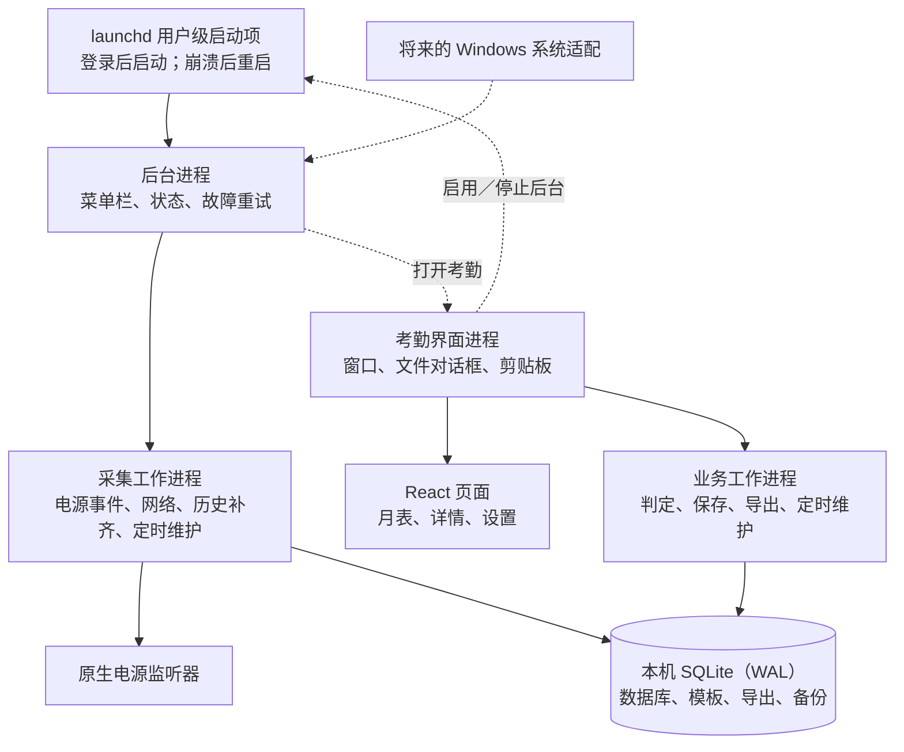

# 个人考勤 Mac 桌面版重构方案

日期：2026 年 10 月 14 日（同日经三轮评审，并按打包验证结果修订）。目标版本：0.2.0。对应施工文档：[详细施工计划](2026-10-14-electron-mac-plan.md)。各轮评审及修订原因见[评审记录](2026-10-14-electron-mac-self-review.md)，打包后的实测结果见[打包验证记录](desktop-spike.md)。

## 1 要做成什么样

把目前需要浏览器和开发环境部署的个人考勤工具，变成本机常驻的 Mac 应用。每个人的数据仍保存在自己的电脑上，月底核对后提交公司 Excel。

采用 Electron 加 React，保留现有的考勤规则、数据库和 Excel 处理代码。界面与后台拆开：退出考勤界面后，后台仍采集，Mac 顶部菜单栏显示运行状态，并提供明确的停止入口。以后增加 Windows 版时，主要补充 Windows 的系统适配。

分发不依赖 Apple 开发者账号，分两种方式：

| 使用者 | 获取方式 | 本机需要 |
| --- | --- | --- |
| 程序员同事 | 克隆仓库，执行一行命令，在本机构建并安装应用 | Node 24、npm、Xcode Command Line Tools |
| 非程序员同事 | 维护者打出同时支持两种芯片的应用包后直接发送 | 无开发环境；首次打开按说明在系统设置中允许 |

首版支持 macOS 13 及以上的 Apple Silicon 和 Intel。Electron 自带运行环境，选定的 Electron 44 系列最低支持 macOS 13。[运行环境说明](https://www.electronjs.org/docs/latest/tutorial/tutorial-prerequisites)、[系统版本要求](https://www.electronjs.org/docs/latest/breaking-changes#removed-macos-12-support)

没有 Developer ID 就无法公证。程序员在本机构建的应用不带下载隔离标记，可以直接打开；发给非程序员的应用会被 Gatekeeper 拦截，须按第 6 节的说明首次打开。以后取得开发者账号时再增加正式签名和公证，不影响本方案的进程结构。

## 2 关闭窗口和退出分别意味着什么

“应用”分为考勤界面和后台服务，两者是独立进程：界面退出不会连带终止后台，后台停止也不会关闭界面。

| 用户操作 | 考勤界面 | 后台采集 | 顶部菜单栏 |
| --- | --- | --- | --- |
| 点击窗口左上角 × 或按 ⌘W | 隐藏窗口，保留未保存编辑 | 继续 | 保留 |
| 点击菜单栏“打开考勤”，或在 Finder、程序坞打开应用 | 显示原窗口；界面未运行时启动 | 继续 | 保留 |
| 按 ⌘Q 或在程序坞选择“退出” | 真正退出界面进程 | 继续 | 保留 |
| 在菜单栏或界面选择“停止后台采集” | 不受影响，未保存编辑保留 | 停止，并取消登录后自动启动 | 消失 |
| 在界面选择“启用后台采集” | 不受影响 | 启动，并在登录后自动启动 | 出现 |
| 系统睡眠、关机或退出登录 | 按系统流程结束或挂起 | 不承诺电脑关闭或用户退出登录期间运行 | 不适用 |
| 下次登录 Mac | 不自动弹出考勤窗口 | 已启用时自动启动 | 恢复 |

隐藏窗口不会清除草稿。真正退出界面前，若有未保存编辑，显示“取消”和“放弃修改并退出”；正在保存或导出时先等待操作完成。不会借“退出”自动提交尚未核对的编辑。

后台未启用、已停止或在系统设置中被关闭时，界面照常完成首次设置、人工核对、邮件复制和 Excel 导出，只是不再记录新的电源和网络事件。重新启用后，系统电源日志能补回期间的开合盖和睡眠唤醒，但补不回当时的网络。

明确停止后台后，自动重启机制不能把它拉起，下次登录也不能恢复；只有用户点击“启用后台采集”才恢复。关机、退出登录和进程崩溃不算明确停止，不改变启用选择。

用户也可以在“系统设置 → 通用 → 登录项与扩展”中关闭后台项目。实测关闭后系统立即停止后台，但不删除启动项。此时应用不能自行重新加载，否则会绕过用户在系统设置中的选择。界面只说明“后台已在系统设置中关闭”，并提供打开该设置页的入口；用户在系统设置中重新打开后，后台立即恢复。

## 3 顶部菜单栏显示什么

菜单栏图标归后台进程所有。普通 Electron 窗口进程退出后，它自己的托盘也会消失，所以不能只给界面加一个图标。[Electron 菜单栏接口](https://www.electronjs.org/docs/latest/api/tray)

正常状态只显示一个窄的模板图标；启动、异常等状态再附加简短文字，避免仅靠颜色区分。实测纯文字标题容易被屏幕刘海挡住，所以常态下不用文字。菜单栏图标较多时，图标仍可能被挡住，说明文档要告诉用户如何找回。菜单包含：

- “采集正常”“正在启动”或“采集异常”，以及最近真实事件时间。
- “打开考勤”和“打开设置”。
- 异常时的“重试后台采集”。
- “停止后台采集”，确认后执行。

“长时间没有电源事件”不等于故障。健康状态看后台进程、采集工作进程和原生监听器是否就绪。后台故障时不能继续显示“采集正常”。界面显示同一状态；后台版本与界面版本不一致时，提示重启后台。

## 4 内部如何分工

一个应用包按启动参数运行两种角色：

- 后台角色由 launchd 以 `--role=agent` 启动，没有窗口，只有菜单栏。采集交给它自己的工作进程，沿用现有原生监听器、网络探测和电源日志补齐，事件直接写入 SQLite。
- 界面角色由用户打开。React 页面通过受限接口访问界面自己的业务工作进程；界面不运行时，这个工作进程也不存在。

两种角色共用同一个数据库，方式与现在采集程序和 Web 服务同时读写同一个库相同：WAL 模式、等锁时间、迁移写锁和定时维护租约都已经实现并在使用。两种角色之间不建立常驻通信：

- 界面根据数据库中的后台状态记录和 launchd 的状态显示后台情况，通过写入或移除启动项来启用或停止后台。
- 菜单栏“打开考勤”通过系统启动界面角色；界面已经在运行时，由单实例机制显示原窗口。

后台是否启用按启动项文件和 launchd 的加载状态共同判断：

| 启动项文件 | launchd 中的任务 | 含义 | 界面的处理 |
| --- | --- | --- | --- |
| 不存在 | — | 未启用，或已由用户停止 | 提供“启用后台采集” |
| 存在 | 已加载 | 已启用 | 按采集健康状态显示 |
| 存在 | 未加载 | 在系统设置中被关闭 | 提示原因并提供系统设置入口，不自行重新加载 |

实测在系统设置中关闭后台项目时，`launchctl print-disabled` 没有任何变化，不能用来判断。

实测后台运行时，从 Finder、Spotlight、菜单栏打开应用或点击后台发出的通知，系统都把请求交给后台进程，而不是已在运行的界面；点击程序坞图标则交给界面本身。后台收到请求后启动界面角色，多余的界面进程会因单实例锁立即退出。点击通知时，后台会同时收到“点击”和“激活”两个事件，因此后台在短时间内只处理一次打开请求。

多个进程同时写库时，单靠 WAL 和等锁时间不够。需要先读后写的操作（判定刷新、保存、恢复自动、确认、锁定、导出登记）必须在同一个写事务中完成：先取得写锁，再读取和写入，避免依据旧数据写入或写入失败。事务内部的函数不再自行开启事务；事务保持简短，生成 Excel 等耗时工作不放在事务里。历史补齐、维护等批量工作拆成多个短事务，否则另一方可能一直等不到写锁。[SQLite 隔离说明](https://www.sqlite.org/isolation.html)

打开数据库时，先设置等锁时间，再切换到 WAL 模式。切换 WAL 需要独占锁，SQLite 为避免死锁不会在这里等待，两个进程同时打开一个新库时会直接报“数据库忙”。实测现有程序的顺序就有这个问题，首次设置时界面和后台几乎同时启动，正好会碰上，因此切换失败时由程序自行退避重试。[SQLite 等锁处理](https://www.sqlite.org/c3ref/busy_handler.html)

事件写入数据库就是持久化，不另建事件日志。采集使用的数据库连接采用完全同步写入，降低突然断电时丢失最后事件的风险。采集工作进程重启或后台停止期间漏掉的电源事件，由系统电源日志补齐；网络事实无法事后还原，相关日期按现有规则提示核对。睡眠前最后一个事件能否落盘须在真机验收，不承诺所有断电情况下零丢失。

业务工作进程按顺序逐条执行界面请求。保存类操作本身是幂等的，重复提交相同内容不会再次修改。工作进程崩溃或超时后，界面不自动重发，按以下顺序处理：

1. 终止旧进程，并确认它已经退出。否则旧进程可能在重新读取之后才完成写入，读到的结果仍不稳定。
2. 启动新进程。
3. 重新读取最新记录，保留草稿。

确认退出且重新读取成功之前，复制邮件和导出保持禁用。

读取月表不是纯读取：判定会刷新自动判定缓存，自动结果变化时会清除当日确认。所以即使用户没有任何操作，邮件和导出所依据的版本也可能变化，界面须说明原因。

导出分三步：

1. 在写事务内取得月表、模板和版本。
2. 在事务外生成文件。
3. 登记导出和锁定月份之前，在新的写事务内再次核对版本。

生成期间如果采集或维护改变了记录，就放弃登记和锁定，提示重新生成，避免文件与锁定记录不一致。

定时维护（每日在线备份、月初草稿、年度提醒）在界面或后台任一运行时执行。两种角色按数据库租约协调，同一时刻只有一个在执行，已完成的项目不重复。两者都没有运行时无法执行，下一次启动时补跑。因此从未启用后台的使用者，只要当天打开过界面，也有当天的备份。

导出文件、备份等由工作进程写在数据目录内；复制到用户选定的导出目录、另存为等访问用户文件夹的操作由界面进程完成。后台进程不访问桌面、文稿、下载等受系统隐私保护的目录，避免后台弹出授权或被拒绝。

## 5 哪些功能保留 哪些需要调整

| 部分 | 重构方式 |
| --- | --- |
| 考勤判定、人工覆盖、确认、锁定 | 保留现有业务规则和回归测试 |
| 无记录工作日待补录 | 保留；确认和正式导出均不能跳过 |
| 未保存编辑拦截、邮件工时 | 保留；保存和恢复期间禁止复制与导出 |
| Excel 模板校验和按原模板写入 | 保留；复制邮件和导出前校验完整版本，版本覆盖记录、个人资料、模板和规则 |
| SQLite 数据库 | 沿用原数据目录及业务表；首版不新增表，确需新增时只追加表或可空列 |
| 月表、日详情、设置界面 | 复用 React 组件及样式，替换 Next.js 路由和服务器操作 |
| 本地网页服务 | 取消，不再占用 3939 端口 |
| Mac 电源、网络、历史补录 | 沿用已验证实现，移入 Mac 适配层 |
| 定时备份、月初草稿、通知 | 两种角色都按租约执行；通知改用应用自身的系统通知 |
| 姓名、工作地点、交通费 | 改为设置页填写，保存在数据库 |
| 安装、升级、卸载 | 程序员使用安装命令；非程序员按说明替换应用 |

本次不改变“首次开盖／唤醒到末次真实睡眠”的考勤口径，也不增加键鼠监控、窗口标题、截图或云端上传。跨零点、无法判断最终下班、多设备工作仍按现有规则人工核对。

## 6 安装和首次使用

### 程序员

克隆仓库后执行 `npm ci && npm run desktop:install`。仓库附带 `.nvmrc`，使用 nvm 的同事执行 `nvm use` 即可切换到 Node 24。安装命令先检查 macOS 版本、Node 主版本和 `swiftc`，缺什么就给出明确提示；然后构建、签名并安装到 `~/Applications`，不需要管理员权限。下载 Electron 运行时需要访问 GitHub，公司网络受限时按 README 设置镜像。

### 非程序员

维护者执行 `npm run desktop:dist`，生成同时支持两种芯片的压缩包并发送。对方解压后，先把应用拖进“应用程序”或个人“应用程序”文件夹，再打开。实测首次打开的步骤如下，压缩包附带一页配截图的说明：

1. 双击应用，系统提示“未打开”，并说明 Apple 无法验证其是否包含恶意软件。只能选“完成”或“移到废纸篓”，选“完成”。
2. 打开“系统设置 → 隐私与安全性”，在“安全性”部分会出现“已阻止……以保护 Mac”，点“仍要打开”，再用触控 ID 或登录密码确认。
3. 再次打开应用即可。之后不会再拦截，移动到“应用程序”以后也不会。

不能在“下载”文件夹或磁盘映像里直接打开后启用后台：实测带隔离标记的应用不移动就打开时，系统会把它放到 `/private/var/folders/…/AppTranslocation/` 下的随机只读位置运行，启动项就会指向失效的路径。应用检测到这种位置时，不允许启用后台，并提示先移动再重新打开。

### 签名

默认使用临时签名。临时签名的身份随每次构建变化，但实测重新构建后覆盖安装，以及从临时签名换成自建证书，都不需要重新允许后台，登录项不会重复，通知权限也保留。安装命令仍支持用自建的代码签名证书获得稳定的身份：证书放在单独的钥匙串文件中即可，不需要在系统中设为信任。README 说明创建方法，但不强制。文件夹访问授权在签名变化后能否保留，打包验证中没有得出结论，留到正式构建验收时确认。

没有开发者账号时，系统无法把后台启动项与应用关联起来。实测“登录项与扩展”里只显示主程序的可执行文件名和通用的“exec”图标，不显示应用名和图标。因此主程序的可执行文件名要让人认得出（正式构建为 `kaoqin`），说明文档也要配图说明登录项里会是什么样子，避免用户误以为是不明程序而关闭。

包内只带程序、匿名模板和原生辅助程序，不带开发者的数据库、日志、环境文件或个人信息。打包时关闭 Electron 中不需要的运行时开关（例如以 Node 方式运行应用、读取 Node 启动参数），并开启包内容完整性校验。[Electron Fuses](https://www.electronjs.org/docs/latest/tutorial/fuses)

自动化界面测试需要读取调试参数，因此使用单独的测试构建。测试构建的应用名称、标识和启动项标签都与正式构建不同，只在开发机上运行，不会被安装。安装命令和发给同事的包都使用正式构建，不为测试放宽开关；正式构建另做安装验收。

### 首次设置

首次设置引导以下几项：

1. 填写姓名、工作地点和交通费。
2. 上传个人模板，并检查姓名是否一致。
3. 标记公司网络。网络要先被记录一次才能标记，首次设置时通常还没有记录，所以这一步可以跳过；之后出现未命名的网络时，界面提示命名并标记。

说明采集内容和数据保存位置后，提供“启用后台采集”；不启用也能完成其余工作。系统设置中关闭了后台项目时，界面说明原因并给出系统设置入口，不自行重新加载，也不把未运行显示为成功。

## 7 升级、卸载和旧版迁移

Mac 继续使用 `~/Library/Application Support/kaoqin/` 作为数据目录，日志继续放在 `~/Library/Logs/kaoqin/`。Electron 自身的缓存放在数据目录的 `electron/` 子目录下并按角色分开，不使用旧版占用的 `app/` 子目录。

数据库只向前迁移。业务工作进程发现需要迁移时，先做在线备份再迁移。过渡期内，新迁移只追加表或可空列，旧程序仍能读写同一个库。以后确有不兼容的变更时，同时在库内登记最低兼容版本，较旧的程序据此拒绝打开并提示升级。

- **程序员升级：** `git pull` 后再执行一次安装命令。
  - 界面仍在运行时，脚本提示先退出界面，避免丢失未保存编辑。
  - 停止后台后，确认后台及其子进程都已退出，才替换应用，并保留上一版副本。原本启用的后台会重新启动。
  - 脚本在数据目录记录一份简单的进度状态。中途中断后再次执行，会先恢复到可用状态，再继续安装。
- **非程序员升级：** 先在菜单栏停止后台并退出界面，替换应用后打开新版本，再点击“启用后台采集”。Finder 不允许替换正在运行的应用，所以必须先停止。
- **卸载：** 程序员执行卸载命令；非程序员先在界面中停止后台，再删除应用。两种方式都默认保留数据库、模板、导出、备份和日志。如果直接删除应用而没有先停止后台，启动项会残留，登录时启动失败；说明文档写明清理方法。

旧版（Web 服务加采集服务）只部署在维护者一台电脑上，用一次性脚本迁移，步骤如下：

1. 在线备份数据库。
2. 从旧部署的 `.env.local` 读取三个邮件字段写入设置。只解析文件，不执行；已有设置不覆盖。
3. 停止旧的两个启动项并移走（保留副本）。
4. 启用新后台。

数据库、模板、人工记录、确认和锁定原样保留。由于新库仍兼容旧程序，回退只需停止新后台、放回旧启动项。旧程序目录里有个人配置文件，验收稳定后由维护者手动删除。

## 8 为 Windows 预留到什么程度

业务代码只接收统一的时间事件、网络信息和数据路径。Mac 的 Swift、`pmset`、`scutil`、launchd 启动项都封装在 Mac 适配层。

Windows 先提供接口和明确的“采集暂不支持”状态，不运行 Mac 命令，不声称已经支持 Windows。以后需要实现 Windows 的电源事件、历史恢复、网络识别、用户登录后的后台启动和安装方式，并在 Windows 真机验收。考勤规则、Excel 导出和大部分界面继续共用。

## 9 首版完成的验收标准

1. 程序员在只装了 Node、npm 和 Command Line Tools 的 Mac 上，用一行命令完成构建、安装和启动；非程序员在没有开发环境的 Mac 上按说明打开通用包。
2. × 仅隐藏窗口，重新打开仍有原草稿；⌘Q 真正退出界面，菜单栏和采集持续运行。
3. 界面退出后，合盖、唤醒仍记录；后台运行的日子定时备份照常执行。
4. 停止后台后不立即复活，下次登录也不擅自启动；停止时界面不受影响。
5. 启用、登录启动、系统设置关闭后台项目、采集进程崩溃和后台版本不一致，都有可验证的状态；在系统设置中关闭后，应用不自行重新加载后台。
6. 从未启用后台时，仍能设置、人工核对、复制邮件和导出；打开过界面的日子有每日备份。
7. 维护者电脑上的旧数据库、个人模板、人工修改、确认、锁定和邮件配置迁移正确，并能按说明回退到旧版。
8. 无记录工作日不能自动算休假；未保存或操作进行中不能复制邮件、不能导出。
9. 邮件、已保存记录和 Excel 时间一致，模板公式和样式保持。资料、模板或规则改变后，旧邮件和导出提示重新生成；生成 Excel 期间记录发生变化时，不登记导出、不锁定月份。
10. 界面与后台同时写库时，没有嵌套事务错误，也没有因读取旧数据导致的写入失败；首次设置时两者同时打开新库也不报错。
11. 后台进程不访问受隐私保护的用户目录；导出到文稿、桌面时，只由界面进程写入。
12. 安装命令中途中断后，再次执行能恢复并完成安装。
13. Apple Silicon 与 Intel 的正式构建分别通过安装、重新安装、重启、睡眠唤醒、升级和卸载验收。

## 10 开工前的小规模验证（已完成）

以下各项只能用实际打包并签名后的应用验证，2026-10-14 已在 Apple Silicon 上完成，详见[打包验证记录](desktop-spike.md)：

| 验证项 | 结果 |
| --- | --- |
| 两种角色并存与打开路由 | 成立。Finder、程序坞、Spotlight、菜单栏和通知打开时都只出现一个窗口，不需要改用独立的辅助应用包 |
| 签名影响 | 两种签名下，覆盖安装都不需要重新允许，登录项不重复；登录项显示为可执行文件名和通用图标；系统设置关闭后台项目可以检测到 |
| 停止与重启 | 先删启动项再停止后不会被拉起；强杀后自动重启，子进程随之退出 |
| 数据库 | Electron 工作进程中建库、迁移、读写和在线备份正常；两个进程同时先读后写各 1000 次无报错；同时打开新库时发现顺序问题，已写入第 4 节 |
| 非程序员首次打开 | 按第 6 节的步骤可以打开，随机转移位置可以检测 |

尚未验证、转入后续验收的项目：

- 后台登录启动时程序坞是否闪现图标；
- 停止后台后重新登录确实不启动；
- 文件夹访问授权与签名身份的关系；
- Intel 机器。

方案采用截至本日的稳定版本作为施工基线。Electron、Chromium 和 Node 会随版本变化，运行兼容性与资源占用以打包验收结果为准。
